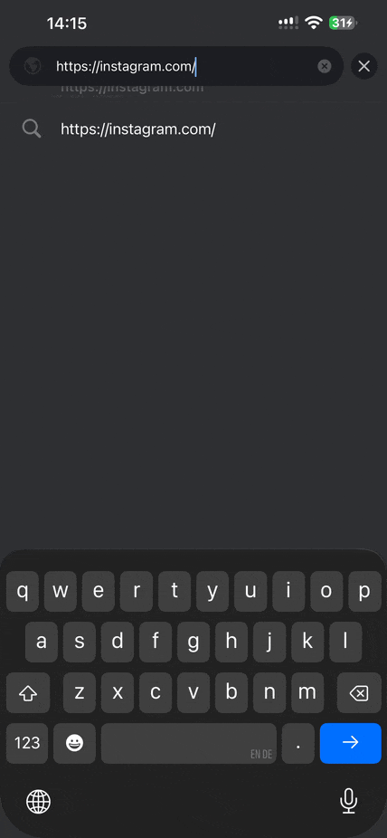
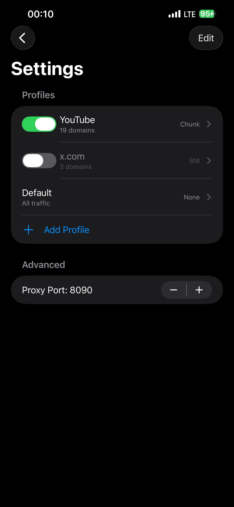
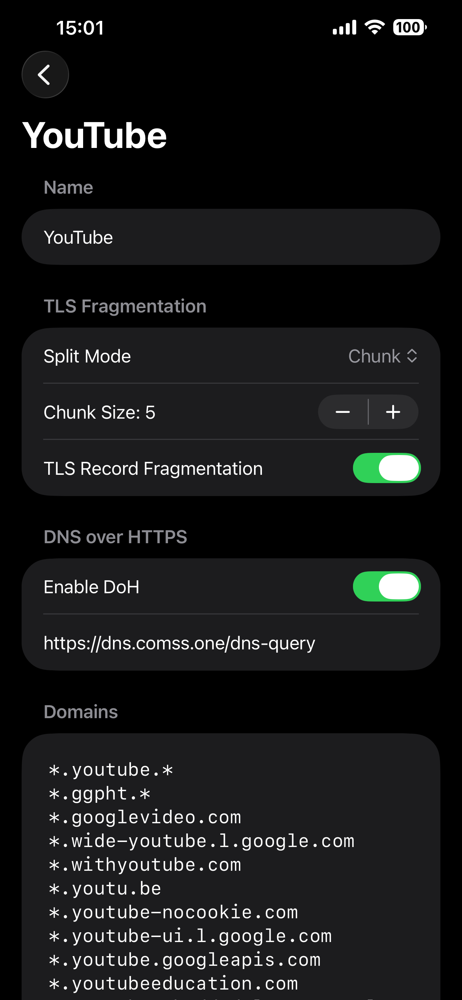
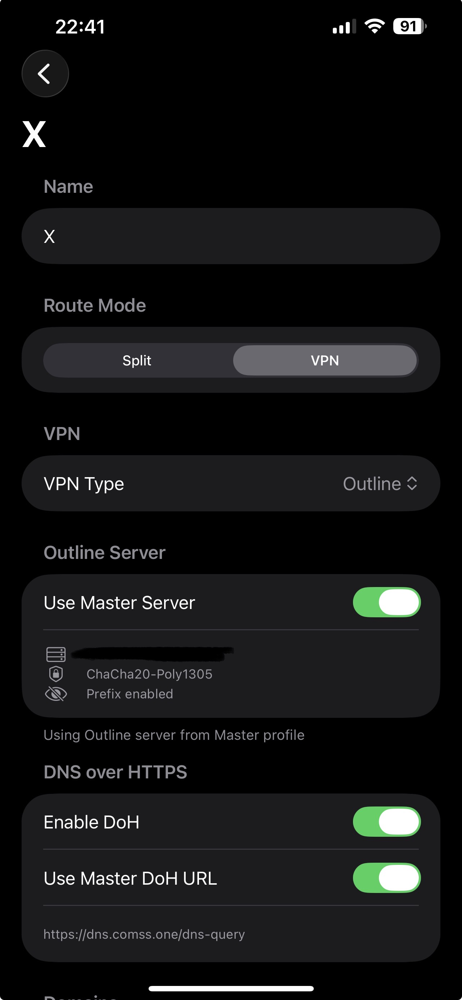
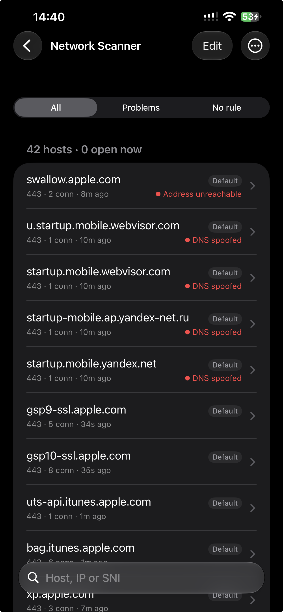
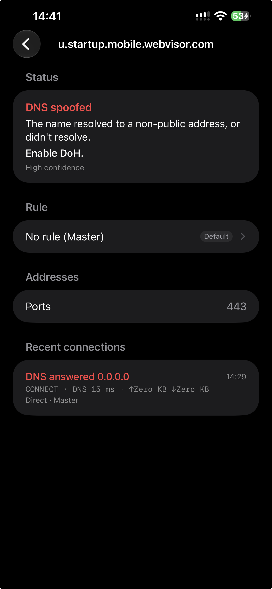

# Spoofy

A DPI (Deep Packet Inspection) bypass tool for iOS and macOS. Inspired by [SpoofDPI](https://github.com/xvzc/SpoofDPI).


Spoofy is a local HTTP/SOCKS5 proxy that bypasses Deep Packet Inspection by fragmenting TLS ClientHello packets or routing selected domains through an Outline server.

> Built with AI coding agents. I designed the app, researched the DPI bypass techniques and verified the behaviour on real devices.

## Features

- HTTP and SOCKS5 proxy — connect via Wi-Fi proxy settings, or directly from any app that supports proxies
- TCP and TLS fragmentation to bypass DPI
- DNS-over-HTTPS to bypass DNS-based blocking
- Outline (Shadowsocks) routing for selected domains
- Per-domain profiles with independent bypass strategies
- Network scanner — see which hosts your apps reach, which look blocked, and add them to a new or existing profile in a few taps
- LAN access — share the proxy with other devices on your network
- Export and import settings through the clipboard



*Network scanner: spot a blocked site and add it to a profile.*

## Limitations

- **No system-wide VPN** — Spoofy is a local proxy, not a VPN. On iOS you can use it via [Wi-Fi proxy settings](#setting-up-wi-fi-proxy-on-iphone) or from an app that supports HTTP/SOCKS5 proxies (like Telegram). Cellular traffic is not covered. See [App Store & VPN Mode](#app-store--vpn-mode) for why.
- **No official App Store release** — you must sideload the app yourself or use the [AltStore source](#altstore). See [App Store & VPN Mode](#app-store--vpn-mode) for details.
- **Limited testing** — verified on physical iOS/macOS devices and with Wireshark packet inspection; no formal security audit. Use at your own risk.

---

## Configuration Guide

### Profiles

Spoofy uses a profile system to apply different bypass strategies to different domains.

<p align="left">
  
  
</p>

#### Master Profile

The **Master** (default) profile applies to all traffic that doesn't match any other profile.

#### Custom Profiles

You can create additional profiles for specific domains that need different settings. A host uses the first enabled profile in the list whose patterns match it; tap **Edit** in Settings to reorder profiles. Hosts that match none use Master.

### Domain patterns

Support wildcards:
| Pattern | Matches |
|---|---|
| `*.example.com` | `www.example.com`, `api.example.com`, etc. |
| `example.*` | `example.com`, `example.org`, etc. |
| `*.youtube.*` | `www.youtube.com`, `m.youtube.co.uk`, etc. |

### Route Mode

Each profile has a **Route Mode** that determines how matched traffic is handled:

| Mode | Description |
|---|---|
| **Split** | DPI bypass — fragments TLS ClientHello using the configured split strategy (default) |
| **VPN** | Routes traffic through a VPN. For now only [Outline (Shadowsocks) server](#outline-server) is supported |

### Split Mode

The core setting that determines how the TLS ClientHello packet is fragmented. Available modes:

| Mode | Description | When to Use |
|---|---|---|
| **SNI** | Splits each character of the hostname into a separate TCP packet | Most effective against SNI-based DPI. Try this first. |
| **Chunk** | Splits the ClientHello into fixed-size chunks | Use when SNI mode doesn't work. Adjust chunk size (1–1000 bytes). |
| **Random** | Applies random pattern-based splitting | Alternative when other modes are detected. |
| **FirstByte** | Sends the first byte separately, then the rest | Lightweight option, may work against simple DPI. |
| **None** | No fragmentation, plain relay | Use for domains that don't need bypassing. |

**Recommendation:** Start with **SNI** mode. If it doesn't work, try **Chunk** with a small chunk size (e.g., 1–5 bytes).

### TLS Record Fragmentation

An additional layer of obfuscation. When enabled, the TLS handshake message is wrapped across multiple TLS records *before* the split mode is applied. This can help bypass DPI that reassembles TLS records before inspecting them.

**Recommendation:** Enable this if your chosen split mode alone doesn't work.

### Outline Server

When the Route Mode is **VPN**, traffic matching that profile's domains is routed through an [Outline](https://getoutline.org/)-compatible Shadowsocks server.



To configure Outline routing paste your Outline server's `ss://` access key into the **Server Configuration** field. Custom profiles can turn on **Use Master Server** to share the Master profile's server instead of keeping their own key.

**Recommendation:** Use Outline mode when you have access to an Outline server for domains where DPI bypass is not enough.

### DNS-over-HTTPS (DoH)

When enabled, DNS queries are sent over HTTPS instead of plain DNS, preventing your ISP or network from seeing which domains you're resolving.

- **DoH Server URL** — the DoH endpoint to use (default: `https://1.1.1.1/dns-query`)
- **Use Master DoH URL** — custom profiles can reuse the Master profile's endpoint

DoH works with both route modes. With **Split**, Spoofy resolves the name over DoH and connects to the result. With **VPN**, it resolves the name over DoH on your device and sends the Outline server the address; with DoH off, the Outline server resolves the name itself, which is usually what you want.

**Recommendation:** Enable this if your ISP blocks domains at the DNS level.

### Network Scanner

<p align="left">
  
  
</p>

Spoofy keeps a log of the connections it carries and judges each host from them. Nothing is sent anywhere and nothing is probed; the scanner only looks at traffic your apps already make.

Open it from the magnifying-glass icon on the main screen, from the summary line under the proxy address (`42 hosts · 3 blocked ›`), or from **Settings → Find Hosts to Add**.

- **Verdicts** — each host gets the block type its connections point to (cut after the TLS hello, address unreachable, DNS spoofed, fake response, HTTP block page, stalls after ~16 KB, network whitelist), in red when the evidence is strong and orange when it's thin. The detail screen explains what it means and what to try. A verdict only counts connections made with the host's current rule, so after you change a profile the host shows *Rule changed* until it is used again.
- **Network banner** — when nothing works (offline), when almost everything except a few sites fails (whitelist mode), or when the Outline server is unreachable, a banner says so and per-host verdicts are held back.
- **Adding hosts** — tap **Edit**, select hosts, then **Add to Profile…** (or long-press a single host). Each host's pattern starts as `*.test.example.com` (the host and its subdomains); pick `*.example.com` (the whole site) from the menu next to it, or edit it by hand — a line below says what it will match. The sheet creates a new profile by default, with a strategy suggested from the block type, or adds to an existing one. The sheet warns when a pattern is already there, when an earlier profile would still catch the host, or when the target profile is off.
- **Details** — tap a host for its addresses, ports, protocol, and a timeline of recent connections.
- **Hide** — long-press to hide noisy hosts (or a whole `*.example.com`). Hidden hosts are still carried, just not listed.
- **Couldn't carry** — requests Spoofy refused (unsupported protocol, malformed request, too many connections) are grouped at the bottom.

If an app connects to an IP address instead of a name, domain rules can't match it. Set the app to resolve names through the proxy (SOCKS5h / remote DNS) to get domain names in the scanner.

The log lives in memory and survives stopping and starting the proxy; **Clear Log** in the scanner menu empties it.

### Advanced Options

#### Proxy Port

The port on which the local proxy server listens. Default is `8090`.

#### Allow LAN Access

When enabled, the proxy server binds to `0.0.0.0` instead of `127.0.0.1`, allowing other devices on the same local network to connect to the proxy. Disabled by default.

This is useful when you want to route traffic from another device (e.g., a computer or tablet) through Spoofy running on your iPhone. On the other device, set the HTTP proxy to your iPhone's local IP address and the configured port.

---

## Setting Up Wi-Fi Proxy on iPhone

You need to manually configure your iPhone's Wi-Fi proxy settings to route traffic through Spoofy.

### Steps

1. **Start Spoofy** — open the app and tap the start button to begin the proxy server
2. Open **Settings** on your iPhone
3. Tap **Wi-Fi**
4. Tap the **ⓘ** icon next to your connected Wi-Fi network
5. Scroll down to **HTTP Proxy** and tap **Configure Proxy**
6. Select **Manual**
7. Enter the following:
   - **Server:** `127.0.0.1`
   - **Port:** `8090` (or whatever port you configured in Spoofy)
   - **Authentication:** leave off
8. Tap **Save**

### Disabling the Proxy

1. Go to **Settings → Wi-Fi → ⓘ (your network) → HTTP Proxy**
2. Change back to **Off**

---

## Install iOS

### AltStore

[AltStore](https://altstore.io/) source: https://raw.githubusercontent.com/ringolol/Spoofy/main/altstore/altsource.json

### App Store & VPN Mode

Spoofy is **not available on the App Store** and does not support VPN mode. Both require an Apple Developer Program membership ($99/year), which the developer does not have. Because of this:

- **No App Store distribution** — you need to build the app yourself with Xcode and sideload it onto your device (e.g., using a free Apple ID or [AltStore](https://altstore.io/)) or use the AltStore source provided. *Though the license permits anyone with a Developer account to publish Spoofy on the App Store.*
- **No VPN mode** — iOS Network Extensions (which enable system-wide VPN-based proxying) require entitlements that are only available through the paid Developer Program. Instead, Spoofy works as a local proxy that you connect to via Wi-Fi proxy settings.

---

## Install macOS

### Option 1: Download from GitHub Releases

1. Go to the [Releases](https://github.com/ringolol/Spoofy/releases) page
2. Download `Spoofy-macOS.zip` from the latest release
3. Extract the zip and move `Spoofy.app` to your Applications folder
4. On first launch, macOS will block the app because it is not signed. Try opening the app and then go to **System Settings → Privacy & Security**, scroll down, and click **Open Anyway**

### Option 2: Build and install with Make

```
make install-macos
```

This builds the Mac Catalyst version, signs it with your development team, and copies it to `/Applications`.

### Setting Up the Proxy on macOS

1. Start Spoofy and tap the start button
2. Open **System Settings → Network → Wi-Fi** (or your active connection)
3. Click **Details…** → **Proxies**
4. Enable **Web Proxy (HTTP)** and **Secure Web Proxy (HTTPS)**
5. Set both to `127.0.0.1` port `8090` (or your configured port)
6. Click **OK**, then **Apply**

---

## For Developers

### Releasing a New Version

```
make release VERSION=1.2 DESCRIPTION="Bug fixes and improvements"
```
Bumps the Xcode project version, archives the app, updates `altsource.json`, and creates a GitHub Release.
